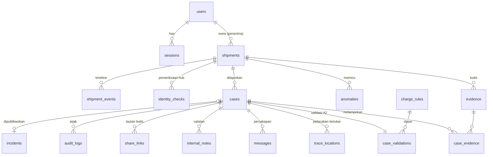

# Master Plan E-Shipmennt

Dokumen arsitektur untuk mengubah prototipe Figma E-Shipmennt menjadi website responsif (PC & mobile) yang benar-benar berfungsi. Dokumen ini menjadi acuan implementasi di folder ini.

- Versi: 1.0 · 20 Nov 2026
- Sumber desain: file Figma `spgPJOBoLzpDn4XbQJca0Y` (E-Shipment), versi "sesudah" revisi P1–P3 dan A1–A3
- Bahasa UI: Indonesia

---

## 1. Tujuan dan ruang lingkup

E-Shipmennt adalah layanan pelacakan paket **berbasis bukti** dan penanganan sengketa (paket tertukar, rusak, tidak diterima). Prinsipnya:

1. Setiap status menyebut sumbernya (pindai, OTP, foto), waktu, dan tempat.
2. Bukti tidak dapat diubah setelah dilaporkan (cap integritas SHA-256).
3. Belum ada pihak yang dinyatakan bersalah selama investigasi berjalan.
4. Insiden yang selesai dipublikasikan tanpa data pribadi.

Target versi pertama (v1): semua layar di desain berjalan dengan data nyata dari database, bisa dipakai di PC dan ponsel, dan bisa di-hosting **gratis**.

## 2. Peran pengguna (2 role)

Tampilan **Operator** (O1–O3) digabung ke **Admin**. Hanya ada dua peran:

| Fitur | Tamu (belum masuk) | Pengguna | Admin |
|---|---|---|---|
| Beranda, Transparansi, Studi kasus, Bantuan | ✓ | ✓ | ✓ |
| Lacak resi (data pribadi disamarkan) | ✓ | ✓ | ✓ |
| Klaim paket miliknya (4 digit akhir telepon penerima) | – | ✓ | – |
| Brankas unboxing: unggah, preview, hapus (P1) | – | ✓ pemilik | lihat saja |
| Laporkan masalah: editor Quill (P2), opsi Lainnya (P3) | – | ✓ pemilik | – |
| Halaman kasus, percakapan, PDF pernyataan, tautan bukti, eskalasi | – | ✓ pelapor | – |
| Tampilan bukti bersama (tautan hanya baca) | ✓ dengan token | ✓ | ✓ |
| Dasbor KPI & antrean anomali (eks O1/O2) | – | – | ✓ |
| Laporan masuk: terima, validasi, reply (A1–A3) | – | – | ✓ |
| Ruang investigasi: perbandingan identitas, status, penugasan, catatan internal (eks O3) | – | – | ✓ |
| Pindai checkpoint (input hasil pindai hub) | – | – | ✓ |
| Log audit, publikasi insiden | – | – | ✓ |

## 3. Arsitektur tingkat tinggi

Satu aplikasi **Next.js (App Router)** berisi front-end dan back-end sekaligus (*modular monolith*). Ini paling sederhana untuk hosting gratis karena cukup satu deployment.

```
┌──────────────────────── Browser (PC / Mobile) ────────────────────────┐
│  React Server Components + Client Components (Tailwind, Quill)        │
└───────────────┬────────────────────────────────────┬──────────────────┘
                │ HTML/RSC                            │ fetch JSON / upload
┌───────────────▼────────────────────────────────────▼──────────────────┐
│ Next.js (Vercel Functions, runtime Node.js)                           │
│  app/(publik)  app/(pengguna)  app/admin      app/api/*  (Route       │
│  ── halaman ──────────────────────────────    Handlers = REST API)    │
│                    │                                │                 │
│            src/server/services  (aturan bisnis, state machine kasus,  │
│                    │             validasi A2, hitung charge, audit)   │
│            src/server/db (Drizzle ORM)     src/server/storage         │
└───────────────┬────────────────────────────────────┬──────────────────┘
                │ SQL (TLS)                           │ signed URL
        ┌───────▼────────┐                   ┌────────▼─────────┐
        │ PostgreSQL     │                   │ Object storage   │
        │ (Supabase/Neon)│                   │ (Supabase Storage)│
        └────────────────┘                   └──────────────────┘
        Lokal: PGlite (Postgres WASM)        Lokal: folder ./.data/uploads
```

Prinsip lapisan:

- **Halaman (UI)** hanya merender dan memanggil API / server action. Tidak ada SQL di komponen.
- **Route handler (`app/api`)** memvalidasi input dengan Zod, memeriksa sesi dan peran, lalu memanggil service.
- **Service (`src/server/services`)** berisi aturan bisnis dan selalu menulis log audit untuk perubahan kasus.
- **DB (`src/server/db`)** berisi skema Drizzle dan koneksi. Driver dipilih otomatis: PGlite bila `DATABASE_URL` kosong, node-postgres (`pg`) bila diisi.
- **Storage (`src/server/storage`)** memakai adapter: `local` (pengembangan) atau `supabase` (produksi).

## 4. Tech stack

| Lapisan | Pilihan | Alasan |
|---|---|---|
| Framework | Next.js 16 + React 19 + TypeScript | Front-end dan back-end satu repo, didukung penuh oleh Vercel gratis |
| Styling | Tailwind CSS 4, token dari desain | Responsif dengan utilitas `md:`/`lg:`, token sama dengan Figma |
| Font | Plus Jakarta Sans, IBM Plex Mono (`next/font`) | Sesuai desain, di-host sendiri tanpa permintaan ke Google saat runtime |
| ORM | Drizzle ORM + drizzle-kit | Ringan, SQL jelas, migrasi berbasis file, cocok untuk serverless |
| Driver DB produksi | node-postgres (`pg` Pool) | Antrean query, tanpa *pipelining*. postgres.js menggantung di pooler transaksi Supabase saat banyak query paralel |
| DB lokal | PGlite (PostgreSQL WASM) | `npm run dev` langsung jalan tanpa instal Postgres/Docker |
| DB produksi | PostgreSQL (Supabase Free atau Neon Free) | Gratis, skema identik dengan lokal |
| Auth | Sesi milik sendiri: bcrypt + token acak di cookie httpOnly, disimpan di tabel `sessions` | Tanpa layanan pihak ketiga, bisa dicabut, mendukung RBAC |
| Validasi | Zod | Satu skema untuk API dan form |
| Rich text (P2) | Quill 2 + `sanitize-html` di server | Sesuai revisi; HTML dibersihkan sebelum disimpan |
| Unggah (P1) | Signed upload URL langsung ke storage | Melewati batas body 4,5 MB fungsi Vercel; video tetap bisa diunggah |
| Google Drive (P1) | Google Picker API (opsional, gratis) | Aktif bila `NEXT_PUBLIC_GOOGLE_*` diisi |
| PDF | pdf-lib | Pernyataan kasus dibuat di server, tanpa browser headless |
| Pembaruan percakapan | Polling 5 detik | Sederhana dan gratis; bisa diganti Supabase Realtime |

## 5. Struktur folder

```
E-Shipment/
├─ docs/MASTER-PLAN.md          ← dokumen ini
├─ drizzle/                     ← file migrasi SQL hasil drizzle-kit
├─ public/                      ← aset statis
├─ scripts/                     ← migrate.ts, seed.ts
├─ src/
│  ├─ app/
│  │  ├─ (publik)/              ← Beranda, Lacak, Transparansi, Studi kasus, Bantuan, Bukti bersama
│  │  ├─ (pengguna)/            ← Lapor, Kasus saya, Kasus detail (butuh login)
│  │  ├─ (auth)/                ← Masuk, Daftar
│  │  ├─ admin/                 ← Dasbor, Laporan, Investigasi, Pindai, Audit, Insiden
│  │  └─ api/                   ← REST API (route handlers)
│  ├─ components/               ← UI kit (Chip, Button, Banner, Card, Timeline, Icon…) + komponen fitur
│  ├─ lib/                      ← util bersama klien/server (format Rupiah, tanggal, masking)
│  └─ server/
│     ├─ db/                    ← schema.ts, client.ts
│     ├─ services/              ← auth, shipments, evidence, cases, validation, admin, incidents, audit
│     ├─ storage/               ← adapter local / supabase
│     └─ http.ts                ← helper respons & guard peran
└─ .env.example
```

## 6. Database

### 6.1 ERD



### 6.2 Tabel utama

| Tabel | Kolom penting | Catatan |
|---|---|---|
| `users` | id, name, email (unik), phone, password_hash, role (`PENGGUNA`/`ADMIN`) | Admin pertama dibuat oleh seed |
| `sessions` | id (hash SHA-256 token), user_id, expires_at | Cookie hanya berisi token mentah |
| `shipments` | awb (unik), courier, service, origin, destination, recipient_name, recipient_phone, owner_id, status, status_source, status_at, eta, eta_confidence, item_value | `owner_id` diisi saat paket diklaim |
| `shipment_events` | shipment_id, occurred_at, kind, title, location, actor, method, identity_result, is_first_mismatch, gap_until | Linimasa C2; `kind`: pickup, hub_scan, no_scan, out_for_delivery, delivered |
| `identity_checks` | shipment_id, seq, hub, checked_at, weight_kg, length/width/height_cm, seal_no, result (`reference`/`match`/`mismatch`/`not_scanned`), is_first_mismatch | Dibandingkan otomatis dengan baris `reference` |
| `evidence` | shipment_id, owner_type (`courier`/`user`), uploaded_by, kind (`pickup`/`handover`/`unboxing`), media_type, source (`device`/`google_drive`/`courier`), file_name, storage_key, mime, size, sha256, locked_at, deleted_at | `locked_at` terisi saat dilampirkan ke laporan, setelah itu tidak bisa dihapus |
| `cases` | code (`KS-0412`), shipment_id, reporter_id, category, category_other, story_html, contact_channel, status, stage_deadline, assignee_id, priority, cause, accepted_at, closed_at, escalated_at, refund_status | Lihat state machine di 7.2 |
| `case_evidence` | case_id, evidence_id | Bukti yang dicentang di C5 |
| `case_validations` | case_id, damaged, insurance, charge_rule_id, charge_manual, charge_total, swapped, found_location_id, redelivery_at, summary | Satu baris per kasus (A2) |
| `charge_rules` | label, percent, flat_amount, active | Contoh ketentuan, dapat diubah admin |
| `trace_locations` | case_id, seq, name, status (`belum`/`tidak_ada`/`ditemukan`) | Daftar lokasi pelacakan barang tertukar |
| `messages` | case_id, sender_role (`pelapor`/`admin`/`sistem`), sender_id, body, kind (`chat`/`keputusan`), created_at | Percakapan dua arah (A3 ↔ C6) |
| `internal_notes` | case_id, author_id, body | Hanya admin |
| `share_links` | case_id, token (unik), expires_at, revoked_at | C7 hanya baca |
| `anomalies` | shipment_id, type (`mismatch`/`stuck`/`no_proof`), severity, hub, detected_at, assignee_id, deadline, resolved_at | Antrean anomali (eks O2) |
| `audit_logs` | case_id?, actor_id?, actor_label, action, detail, created_at | Tidak pernah di-update atau dihapus |
| `incidents` | code (`INC-2026-031`), type, title, cause, resolution_days, fix, period, case_id?, published_at | Halaman Transparansi (C10) |

Indeks: `shipments.awb`, `cases.code`, `cases.status`, `messages(case_id, created_at)`, `audit_logs(case_id, created_at)`, `share_links.token`.

### 6.3 Aturan integritas data

- **Cap integritas**: server menghitung SHA-256 tiap berkas setelah unggah selesai. Hash ditampilkan di UI dan di PDF. Bila berkas diubah, hash tidak lagi cocok.
- **Tidak dapat diubah**: bukti dengan `locked_at` tidak bisa dihapus. `audit_logs` hanya *insert*.
- **Data pribadi**: tampilan publik dan tautan bukti bersama memakai masking (`D••• A•••`, telepon `••••-••••-•••`). Nama asli hanya untuk pemilik dan admin.

## 7. Back-end

### 7.1 Daftar API

| Metode & path | Peran | Fungsi |
|---|---|---|
| `POST /api/auth/register` · `login` · `logout` | publik | Daftar, masuk, keluar |
| `GET /api/auth/me` | semua | Sesi aktif |
| `GET /api/shipments/:awb` | publik | Data lacak (dimasking untuk non-pemilik) |
| `POST /api/shipments/:awb/claim` | Pengguna | Klaim paket dengan 4 digit akhir telepon |
| `POST /api/evidence/upload-url` | Pengguna pemilik | Minta URL unggah (local / Supabase signed URL) |
| `PUT /api/evidence/local-upload/:key` | Pengguna | Tujuan unggah mode lokal |
| `POST /api/evidence` | Pengguna pemilik | Daftarkan berkas setelah unggah, hitung SHA-256 |
| `POST /api/evidence/drive` | Pengguna pemilik | Impor berkas dari Google Drive (token Picker) |
| `DELETE /api/evidence/:id` | Pengguna pemilik | Hapus bila belum terkunci |
| `GET /api/evidence/:id/file` | pemilik/admin/tautan | Stream atau redirect ke berkas |
| `POST /api/cases` | Pengguna pemilik | Kirim laporan (C5) |
| `GET /api/cases/:code` | pelapor/admin | Detail kasus |
| `GET/POST /api/cases/:code/messages` | pelapor/admin | Percakapan |
| `POST /api/cases/:code/escalate` | pelapor | Eskalasi bila batas waktu terlewat |
| `POST /api/cases/:code/share` · `DELETE` | pelapor | Buat atau cabut tautan bukti |
| `GET /api/cases/:code/statement.pdf` | pelapor/admin | Pernyataan kasus PDF |
| `POST /api/admin/cases/:code/accept` | Admin | A1: Baru → Diproses |
| `PUT /api/admin/cases/:code/validation` | Admin | A2: simpan jawaban validasi, hitung charge, ringkasan |
| `PUT /api/admin/cases/:code/trace/:locId` | Admin | A2: status lokasi pelacakan |
| `POST /api/admin/cases/:code/redelivery` | Admin | Jadwalkan pengiriman ulang |
| `POST /api/admin/cases/:code/decision` | Admin | Kirim ringkasan keputusan ke pelapor |
| `PATCH /api/admin/cases/:code` | Admin | Status, penugasan, penyebab |
| `POST /api/admin/cases/:code/notes` | Admin | Catatan internal |
| `POST /api/admin/cases/:code/close` | Admin | Tutup laporan (wajib penyebab + pesan) |
| `POST /api/admin/scans` | Admin | Pindai checkpoint, perbandingan identitas otomatis |
| `POST /api/admin/incidents` | Admin | Publikasikan insiden dari kasus selesai |

Mutasi dari form halaman memakai *Server Actions* bila lebih ringkas. Aturan bisnisnya tetap di service yang sama.

### 7.2 State machine kasus

```
BARU ──terima (A1)──► DIPROSES ──penyebab ditetapkan──► PENYEBAB_DITEMUKAN ──tutup──► SELESAI
  └───────────────────────────────── tutup (validasi lengkap + pesan) ──────────────────┘
```

- Pemetaan label: admin melihat **Baru / Diproses / Selesai** (A1). Pengguna melihat stepper **Diterima → Diselidiki → Penyebab ditemukan → Selesai** (C6).
- Setiap transisi menulis `audit_logs` dan pesan sistem ke percakapan.
- Batas waktu tahap: 3 hari sejak status terakhir (dapat dikonfigurasi). Lewat batas → tombol eskalasi aktif dan prioritas naik.

### 7.3 Aturan validasi (A2)

- "Apakah barang rusak?" **Ya** → pilih *diganti asuransi* atau *tidak diganti asuransi*.
- *Tidak diganti asuransi* → panel charge: pilih ketentuan (`charge_rules`), isi penyesuaian manual (opsional). `total = manual ?? (percent × nilai barang + flat)`.
- "Apakah barang tertukar?" **Ya** → daftar lokasi pelacakan dibuat otomatis dari rute paket + "Gudang penjual". Status tiap lokasi: Belum diperiksa / Tidak ada / Ditemukan. Bila ada yang ditemukan, progres selesai dan tombol "Jadwalkan pengiriman ulang" aktif.
- Ringkasan keputusan dibuat otomatis dari jawaban. "Kirim keputusan ke pelapor" dan "Tutup laporan" aktif hanya bila kedua pertanyaan terjawab dan cabangnya lengkap.

### 7.4 Perbandingan identitas otomatis (eks O3, "Pindai checkpoint")

Saat admin memasukkan hasil pindai hub (berat, ukuran, segel), server membandingkannya dengan catatan pengambilan:

- Toleransi berat ±2%, ukuran harus sama, segel harus sama.
- Beda → `result = mismatch`. Bila belum ada mismatch sebelumnya, tandai `is_first_mismatch` dan buat `anomaly` tingkat Tinggi.
- Tambah `shipment_events` sehingga linimasa pengguna langsung terbarui.

### 7.5 Keamanan

- Password di-hash dengan bcrypt (cost 10). Cookie sesi `httpOnly`, `secure`, `SameSite=Lax`, berlaku 30 hari.
- Guard peran di setiap route handler (`requireUser`, `requireAdmin`) dan di `proxy.ts` untuk prefix `/admin`.
- Mutasi menolak permintaan dengan header `Origin` asing (perlindungan CSRF).
- HTML cerita disanitasi (hanya `p, br, strong, em, u, ol, ul, li`).
- Unggahan dibatasi: `image/*` dan `video/*`, maks 50 MB, nama berkas dinormalisasi, kunci storage acak.
- Tautan bukti memakai token acak 32 byte dengan masa berlaku dan bisa dicabut.

## 8. Front-end

### 8.1 Peta halaman ↔ desain Figma

| Route | Layar desain | Akses |
|---|---|---|
| `/` | C1 Beranda | publik |
| `/lacak` · `/lacak/[resi]` | C2 Hasil pelacakan (Linimasa) | publik |
| `/lacak/[resi]/rute` | C4 Rute & identitas | publik |
| `/lacak/[resi]/bukti` | C3 Bukti + Brankas unboxing (P1) | publik; brankas untuk pemilik |
| `/lapor/[resi]` | C5 Laporkan masalah (P2, P3) | pengguna pemilik |
| `/kasus` · `/kasus/[kode]` | C6 Halaman kasus + percakapan | pelapor |
| `/bukti/[token]` | C7 Tampilan bukti bersama | pemegang tautan |
| `/transparansi` | C10 Pengungkapan insiden | publik |
| `/studi-kasus` | C9 Studi kasus | publik |
| `/bantuan` | Bantuan + kontak JNE | publik |
| `/masuk` · `/daftar` | Autentikasi | publik |
| `/admin` | Dasbor & antrean anomali (eks O1/O2) | admin |
| `/admin/laporan` · `/admin/laporan/[kode]` | A Laporan masuk (A1–A3) + Ruang investigasi (eks O3) dalam tab | admin |
| `/admin/pindai` | Pindai checkpoint | admin |
| `/admin/audit` | Log audit | admin |
| `/admin/insiden` | Kelola pengungkapan insiden | admin |

### 8.2 Strategi responsif

Breakpoint mengikuti frame Figma: mobile 390, tablet `md` 768, desktop `lg` 1024 dengan kontainer maksimum 1280 (admin 1440).

- **Navbar**: desktop memakai navbar horizontal (Beranda, Lacak, Transparansi, Studi kasus, Bantuan, CTA "Laporkan masalah", Masuk/Akun). Mobile memakai header + drawer ☰ dengan item yang sama.
- **Halaman pelacakan**: mobile memakai tab Linimasa/Rute/Bukti dan bar aksi lengket di bawah. Desktop memakai dua kolom (ringkasan kiri, konten tab kanan).
- **Admin**: desktop memakai sidebar tetap dan tampilan *list–detail* tiga kolom (daftar, detail, percakapan). Mobile memakai drawer menu, daftar dan detail di halaman terpisah, dan percakapan di bawah detail.
- Target sentuh minimal 44 px, tabel lebar dibungkus `overflow-x-auto`, tidak ada scroll horizontal halaman.

### 8.3 Komponen UI kit

Diturunkan dari komponen Figma: `Chip` (ok/wn/er/nu/nb), `Button` (primary/secondary/white/danger, ukuran), `IconButton`, `Banner`, `Card`, `KV` (pasangan label-nilai), `Timeline`, `Stepper`, `Tabs`, `FilterChip`, `ProgressBar`, `Segmented` (Ya/Tidak), `Placeholder`, `Stamp` (cap integritas), `Icon` (22 ikon SVG asli), `Navbar`, `MobileHeader`, `Drawer`, `Modal`, `Sheet`.

Komponen fitur: `Brankas` (unggah, carousel, thumbnail, preview layar penuh, hapus, pemilih sumber), `RichEditor` (Quill), `ReportForm`, `CaseChat`, `ValidationCard`, `ChargePanel`, `TracePanel`, `AnomalyTable`, `ComparisonTable`.

### 8.4 Token desain

Token CSS dari prototipe dipetakan ke `@theme` Tailwind: `navy #14305B`, `navy-d #0D2142`, `blue #1B4B8F`, `bg #F4F6F9`, `card #FFFFFF`, `line #D8DFE9`, `txt #16202E`, `mut #52607A`, pasangan status `ok/wn/er/nu/nb`, radius 8 px.

## 9. Pemetaan revisi ke implementasi

| Revisi | Implementasi |
|---|---|
| P1 Upload File | `Brankas`: tombol Upload File → sheet pilih sumber (Perangkat / Google Drive). Foto dan video, carousel + thumbnail + penghitung, preview layar penuh, hapus (hanya bila belum terkunci) |
| P2 Quill | `RichEditor` memakai Quill 2 (tebal, miring, garis bawah, daftar bernomor, daftar butir, hapus format). Disanitasi di server |
| P3 Lainnya | Opsi "Lainnya" memunculkan kotak teks wajib. Tombol Kirim nonaktif sampai terisi; server juga menolak bila kosong |
| A1 Terima laporan | Tombol mengubah Baru → Diproses, mencatat audit, mengirim pesan sistem ke pelapor |
| A1 Percakapan | Panel percakapan dua arah, sinkron dengan halaman kasus pengguna (memperbaiki keterbatasan prototipe) |
| A2 Validasi | `ValidationCard` + `ChargePanel` + `TracePanel`, ringkasan otomatis, tombol kirim/tutup dengan syarat |
| A3 Reply | Template "Laporan diterima", "Minta foto tambahan", "Paket dilacak" mengisi kotak balasan |

## 10. Server dan hosting gratis (Rp0)

### 10.1 Rekomendasi: Vercel Hobby + Supabase Free

| Layanan | Dipakai untuk | Kuota gratis (cek ulang sebelum rilis) |
|---|---|---|
| **Vercel Hobby** | Hosting Next.js (halaman + API) | ±1 juta invocation fungsi/bulan, 100 GB transfer, HTTPS + subdomain `*.vercel.app`. **Hanya untuk penggunaan pribadi/non-komersial.** Melebihi kuota → dijeda, tidak ditagih |
| **Supabase Free** | PostgreSQL + Storage berkas bukti | DB 500 MB per proyek, storage 1 GB, egress 5 GB, 2 proyek aktif. **Proyek dijeda setelah 7 hari tidak aktif** |
| **GitHub** | Repo + GitHub Actions | Gratis; dipakai juga untuk cron "keep-alive" Supabase |
| **Google Cloud (opsional)** | Google Picker API untuk impor Drive | Gratis untuk Picker; butuh OAuth Client ID + API key |

Tidak perlu kartu kredit untuk ketiga layanan utama.

### 10.2 Alternatif

- **Neon Free** sebagai pengganti DB: 1 GB per proyek, 100 CU-jam/bulan, compute tidur otomatis lalu bangun sendiri saat diakses (tidak perlu keep-alive). Berkas tetap di Supabase Storage.
- **Cloudflare Pages/Workers + D1/R2**: kuota besar, tetapi butuh penyesuaian runtime (edge) dan R2 meminta data pembayaran. Tidak direkomendasikan untuk v1.
- **Netlify Free**: bisa menjalankan Next.js, kuota lebih kecil dari Vercel.

### 10.3 Batasan yang harus diketahui

- Vercel Hobby tidak boleh dipakai komersial. Bila E-Shipmennt menjadi layanan nyata, naik ke Vercel Pro atau pindah ke VPS.
- Supabase Free yang dijeda butuh dipulihkan manual di dashboard. Workflow `keep-alive` (GitHub Actions, tiap 3 hari) mencegahnya.
- Batas body fungsi Vercel 4,5 MB → unggahan selalu langsung ke storage memakai signed URL.
- Storage 1 GB cukup untuk demo (±200 foto 2 MB + beberapa video pendek). Kompres video sebelum unggah untuk pemakaian lebih lama.

### 10.4 Langkah deploy

1. Buat proyek Supabase → salin *connection string* (mode pooler, port 6543) dan buat bucket privat `evidence`.
2. Isi variabel lingkungan di Vercel (lihat `.env.example`): `DATABASE_URL`, `SESSION_SECRET`, `STORAGE_DRIVER=supabase`, `SUPABASE_URL`, `SUPABASE_SERVICE_ROLE_KEY`, `SUPABASE_BUCKET=evidence`, `ADMIN_EMAIL`, `ADMIN_PASSWORD`, opsional `NEXT_PUBLIC_GOOGLE_CLIENT_ID`, `NEXT_PUBLIC_GOOGLE_API_KEY`, `NEXT_PUBLIC_GOOGLE_APP_ID`.
3. Jalankan migrasi dan seed sekali dari komputer: isi `DATABASE_URL`, `ADMIN_EMAIL`, `ADMIN_PASSWORD` di `.env.production.local`, lalu `npm run db:migrate:prod && npm run db:seed:prod`.
4. Atur *Function Region* Vercel sama dengan region Supabase (mis. Mumbai `bom1` untuk `ap-south-1`) agar query tidak lintas benua.
5. Hubungkan repo GitHub ke Vercel → deploy otomatis setiap push ke `main`.
6. Aktifkan workflow `keep-alive` dengan secret `SITE_URL`.
7. Cek `https://<domain>/api/health`: harus `ok: true`, `db: postgres`, `seeded: true`, tanpa `storageWarning`.

## 11. Fase implementasi

| Fase | Isi | Status |
|---|---|---|
| 0 | Master plan, scaffold Next.js, token desain, UI kit, ikon | ✓ |
| 1 | Skema DB, migrasi, seed data contoh (resi JT110461625999, kasus KS-0412/0411/0409/0405, insiden) | ✓ |
| 2 | Auth + RBAC (Pengguna, Admin) | ✓ |
| 3 | Halaman publik: Beranda, Lacak (Linimasa/Rute/Bukti), Transparansi, Studi kasus, Bantuan | ✓ |
| 4 | Brankas P1, Lapor P2/P3, Halaman kasus, Tautan bukti, PDF, Eskalasi | ✓ |
| 5 | Admin: Dasbor & antrean, Laporan masuk A1–A3, Investigasi, Pindai checkpoint, Audit, Insiden | ✓ |
| 6 | Deploy Vercel + Supabase, keep-alive, uji di perangkat nyata | menunggu akun pemilik |
| 7 (lanjutan) | Notifikasi WhatsApp/email, Supabase Realtime, integrasi API kurir nyata, unit test service | rencana |

## 12. Pengujian

- `npm run typecheck` dan `npm run build` wajib lulus sebelum deploy.
- `npm run smoke` menjalankan skenario end-to-end lewat API: daftar → klaim → unggah → lapor → admin terima → validasi → reply → tutup.
- Uji manual responsif di lebar 390, 768, 1280, dan 1440.

## 13. Risiko dan keputusan terbuka

- Data kurir masih **data contoh** dari seed. Integrasi API JNE resmi butuh kerja sama bisnis.
- Nilai charge ("50% nilai barang") adalah contoh, bukan ketentuan resmi.
- Google Drive memerlukan proyek Google Cloud milik pemilik. Tanpa itu, opsi Drive tampil nonaktif dengan keterangan.
- Kontak JNE di halaman Bantuan perlu dicek ulang berkala ke jne.co.id.
